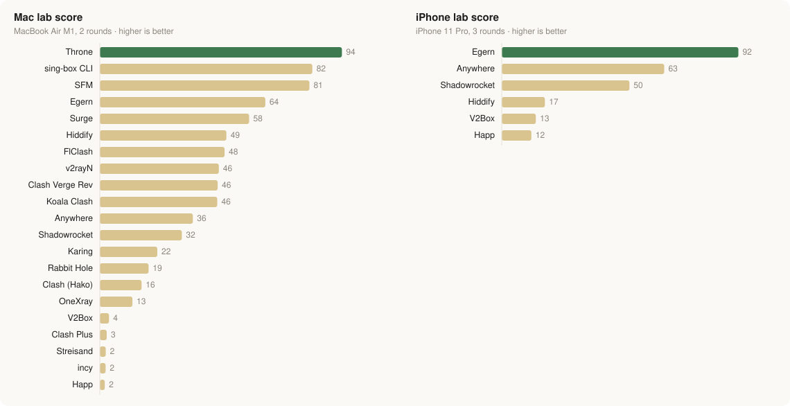

# Tunnel Atlas

**Which proxy client app is fastest and lightest on the battery?** A benchmark of 21 apps on a Mac and 6 on an iPhone (October 2026), plus a field guide to VPN and proxy protocols.

**Live site: https://0xahp.github.io/tunnel-atlas/**

## Proxy client benchmark

Each app tunnels identical traffic, one at a time, to a Shadowsocks 2022 test server on the same device. With no network in the way, the results show each app's own speed and energy cost.

<picture>
  <source media="(prefers-color-scheme: dark)" srcset="assets/lab-score-dark.svg">
  
</picture>

*Score = 100 × (speed ÷ best speed)^0.3 × (best energy per GB ÷ energy per GB)^0.7. Mac: energy of the app's tunnel process at a steady 200 Mbit/s. iPhone: whole-phone extra power at 200 Mbit/s, from the battery gauge.*

- **Mac lab** (MacBook Air M1, macOS 27): 20 apps plus the sing-box command line, 2 rounds. Throne, the sing-box command line and SFM score highest; Egern uses the least energy per GB.
- **iPhone lab** (iPhone 11 Pro, iOS 27): 6 apps, 3 rounds, run overnight with nobody touching the phone. Egern leads on efficiency; Anywhere is the fastest.
- **Real use costs more:** in an earlier test through real servers, two chained proxies with routing rules used about 3× the energy per GB of a single proxy.

**[See every measure →](https://0xahp.github.io/tunnel-atlas/#bench)** speed over 1 and 4 connections, energy, CPU and memory at 200 Mbit/s, idle cost on the iPhone, and what is inside each app.

Independent, non-commercial testing on one Mac and one iPhone. Results depend on the device, the OS and the app version.

## Also on the site

- **[Routes](https://0xahp.github.io/tunnel-atlas/#setup)**: the top setups for 2026 for three situations (no censorship, a censored country, a shutdown or allowlist), with a diagram of who sees what along the path.
- **[Timeline](https://0xahp.github.io/tunnel-atlas/#timeline)**: 58 VPN and proxy techniques, newest to oldest, each with its 2026 status in Iran, China, Russia and Turkmenistan, how it connects, and an estimate of its battery cost on a phone.
- **[Sources](https://0xahp.github.io/tunnel-atlas/sources.html)**: every reference behind the figures, plus censorship status by country and the claims that were checked.

## Notes

- Results can change with app updates; the site lists the versions tested.
- Censorship status reflects reports up to October 2026 and changes week to week.
- Battery figures for proxy protocols in the timeline are estimates; the only phone measurement covers five classic VPNs (2022).
- A static site: plain HTML, CSS and JavaScript, no build step.
