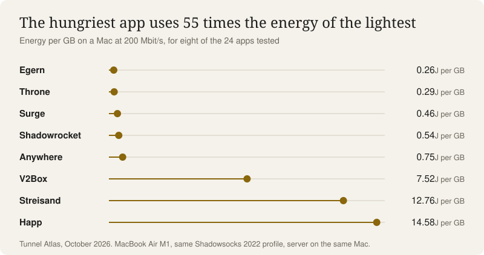
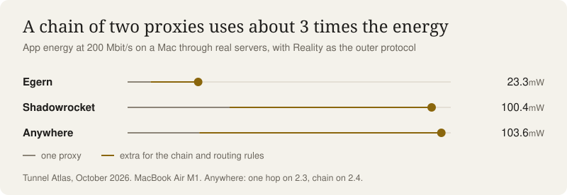

English | [简体中文](README.zh-CN.md) | [فارسی](README.fa.md)

# Tunnel Atlas: which proxy app is fastest and lightest on the battery?

Throne leads on a Mac and Egern leads on an iPhone. We tested 23 proxy client apps plus the sing-box command line on a Mac, and 7 apps on an iPhone, with identical traffic, one at a time.

**Read it on the site: https://0xahp.github.io/tunnel-atlas/**

- **On a Mac:** Throne ranks first, at 16.9 Gbit/s and 0.29 J per GB.
- **On an iPhone:** Egern ranks first. It adds about half the energy per GB of Anywhere, the fastest iPhone app.
- **Pick by energy:** the hungriest Mac app uses 55 times the energy per GB of the lightest.
- **Real setups cost more:** a chain of two proxies with routing rules used about 3 times the energy of one proxy.

## The ranking

The score weighs energy efficiency at 70% and speed at 30%, because the top apps are already far faster than any internet connection. The labs run the test server on the device itself, so the results show the app's own cost and nothing from the network.

**Mac (MacBook Air M1)**

| Rank | App | Score | Average speed | Energy at 200 Mbit/s |
|---:|---|---:|---:|---:|
| 1 | [Throne](https://0xahp.github.io/tunnel-atlas/apps/throne.html) | 94 | 16.9 Gbit/s | 0.29 J per GB |
| 2 | [sing-box command line](https://0xahp.github.io/tunnel-atlas/apps/sing-box-cli.html) | 82 | 16.3 Gbit/s | 0.34 J per GB |
| 3 | [SFM](https://0xahp.github.io/tunnel-atlas/apps/sfm.html) | 81 | 9.58 Gbit/s | 0.28 J per GB |
| 4 | [Egern](https://0xahp.github.io/tunnel-atlas/apps/egern.html) | 64 | 3.87 Gbit/s | 0.26 J per GB |
| 5 | [Surge](https://0xahp.github.io/tunnel-atlas/apps/surge.html) | 58 | 10.2 Gbit/s | 0.46 J per GB |

**iPhone (iPhone 11 Pro)**

| Rank | App | Score | Average speed | Extra energy at 200 Mbit/s |
|---:|---|---:|---:|---:|
| 1 | [Egern](https://0xahp.github.io/tunnel-atlas/apps/egern.html) | 92 | 2.46 Gbit/s | 6.2 J per GB |
| 2 | [Anywhere](https://0xahp.github.io/tunnel-atlas/apps/anywhere.html) | 63 | 3.27 Gbit/s | 12 J per GB |
| 3 | [Shadowrocket](https://0xahp.github.io/tunnel-atlas/apps/shadowrocket.html) | 50 | 1.16 Gbit/s | 10.8 J per GB |

See [all 24 Mac results](https://0xahp.github.io/tunnel-atlas/data.html#mac) and [all 7 iPhone results](https://0xahp.github.io/tunnel-atlas/data.html#iphone). Every app also has its own page.

## Energy is the real gap

Speed rarely limits you. Happ, the slowest app on the Mac, still averaged 0.38 Gbit/s. Energy is where apps differ: Happ used 14.6 J per GB, against 0.26 for Egern. On the iPhone the same spread is about 7 times, from 6.2 to 44.3 J per GB.

<picture>
  <source media="(prefers-color-scheme: dark)" srcset="assets/graph-energy-dark.svg">
  
</picture>

## Real use costs more

On the Mac, through real servers over the internet, Egern drew 7.6 mW at 200 Mbit/s, Anywhere 23.7 and Shadowrocket 33.7. Adding a second proxy and everyday routing rules roughly tripled that for Egern and Shadowrocket.

<picture>
  <source media="(prefers-color-scheme: dark)" srcset="assets/graph-chain-dark.svg">
  
</picture>

## Check your MTU

MTU is the size of the tunnel's packets. At the common 1500, an app handles about 2.7 times more packets per GB than at 4000. Raising it from 1500 to 4000 lifted SFM's upload from 10.8 to about 14.3 Gbit/s. On the Mac, the seven apps at 1500 or below are all among the nine slowest, so set 4000 wherever your app allows it.

## What to run in 2026

- **No censorship:** run WireGuard.
- **Censored country:** start with VLESS + REALITY on your own domain and keep Hysteria2 as a backup.
- **Shutdown or allowlist:** use a relay inside the country.

[Routes](https://0xahp.github.io/tunnel-atlas/routes.html) has each setup, the path it takes and who sees what along the way.

## More on the site

- **[Timeline](https://0xahp.github.io/tunnel-atlas/timeline.html):** thirty years of VPN and proxy tunnels, and what works in Iran, China, Russia and Turkmenistan in 2026.
- **[All the numbers](https://0xahp.github.io/tunnel-atlas/data.html):** sortable tables for every app, every route, censorship by country and all 58 techniques.
- **[Sources and method](https://0xahp.github.io/tunnel-atlas/sources.html):** the full method, its limits, 37 checked claims and every reference.

## How we tested

A MacBook Air M1 and an iPhone 11 Pro ran each app in turn with the same Shadowsocks 2022 profile: two rounds on the Mac, three on the iPhone. Each app was tested for speed over 1 and 4 connections and for energy during a steady 200 Mbit/s download. Exceptions are listed in the [full method](https://0xahp.github.io/tunnel-atlas/sources.html#method), and the raw results are in [`bench/experiments.json`](bench/experiments.json).

These are the results of one Mac and one iPhone, with versions as installed on 20–22 Oct 2026, and yours will depend on your device, OS and app version. Censorship status comes mostly from user reports up to October 2026 and changes week to week.

Independent, non-commercial testing.
