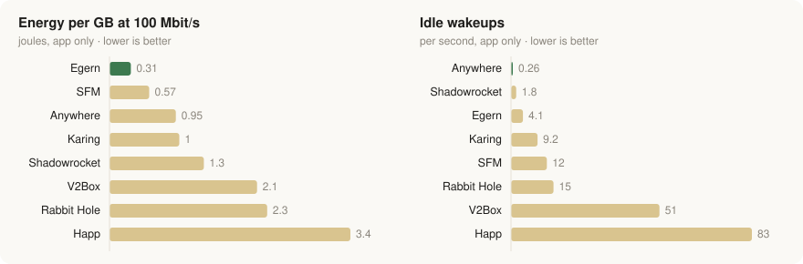

# Tunnel Atlas

**Which proxy client app on macOS costs the least battery and CPU?** A field test of eight apps on one Mac, October 2026, plus a field guide to VPN and proxy protocols.

**Live site: https://0xahp.github.io/tunnel-atlas/**

## Proxy client benchmark

**What started it:** [a September 2026 post](https://x.com/grgerwcwetwet/status/2099466023472877777) showing sing-box 1.15's new TCP/IP stack reaching 12.6 Gbit/s upload and 14.9 Gbit/s download in an iPhone loopback test, ahead of Loon, Quantumult X, Surge, Stash and Shadowrocket. Peak speed is one thing; I wanted to know what these apps cost in battery and CPU on everyday traffic. (The speed part held up here too: SFM, sing-box's Mac app, was the fastest in the lab test at 10.2 Gbit/s upload.)

Eight proxy client apps for macOS (Anywhere, SFM, Egern, Shadowrocket, Karing, Rabbit Hole, V2Box, Happ) sent the same traffic through the same servers, one app at a time and in a rotating order, on a MacBook Air M1 running on battery with every app window closed.

<picture>
  <source media="(prefers-color-scheme: dark)" srcset="assets/basic-efficiency-dark.svg">
  
</picture>

*Left and middle: basic setup (one proxy, no rules), median of 4 rounds, with Anywhere 2.3. App energy and wakeups are macOS's own per-process figures for each app's tunnel process. Right: top upload in the lab on the same Mac (1 round); Anywhere's bar is its 2.4 recheck from 17 Oct, run alone with a profiler attached.*

| Place | App | Score (lower is better) |
|---|---|---|
| 1 | Egern | 2.63 |
| 2 | Anywhere | 2.90 |
| 3 | SFM | 3.76 |
| 4 | Karing | 3.83 |
| 5 | Shadowrocket | 4.13 |
| 6 | Rabbit Hole | 5.27 |
| 7 | V2Box | 6.60 |
| 8 | Happ | 6.88 |

Score = 35% efficiency under traffic + 35% efficiency at idle + 30% performance; each part is the app's average place across its measures.

**Three setups, measured separately**

- **Chain + rules**: the everyday setup, with two chained proxies and routing rules. 4 apps, 6 rounds.
- **Basic**: one proxy, no rules, everything through the tunnel. 8 apps, 4 rounds.
- **Top speed**: a lab test on the Mac itself, with no internet in the way. 8 apps, 1 round (a first look, not a ranking).

**What held across the setups**

- Egern used the least CPU and energy per GB in both real-network setups.
- Anywhere woke the CPU least when idle in both real-network setups, but in Chain + rules (after its 2.4 update) its average idle power was the highest.
- Happ and V2Box ranked last in the Basic setup and were the two slowest in the top-speed test.
- For the whole Mac, the apps were within a few percent of each other.
- On an iPhone 11 Pro (iOS 27, Chain + rules, 2 rounds, whole-phone power), Anywhere and Egern tied: 0.93 W vs 0.93–0.95 W at a steady 50 Mbit/s download, with the same speed and page times within noise. The Mac's ~4× gap in app energy per GB is in the app's own small share of power and doesn't show at the whole-device level.

**[See every measure for all three setups →](https://0xahp.github.io/tunnel-atlas/#bench)** average idle power, power and CPU under load, top speed and time to first byte, with app versions.

Footnote: this is not a professional lab test, just a personal, nerdy-interest one: one Mac on Wi-Fi, a few days, a handful of rounds. On a phone over cellular the results may differ.

## Also on the site

- **[Routes](https://0xahp.github.io/tunnel-atlas/#setup)**: the top setups for 2026 for three situations (no censorship, a censored country, a shutdown or allowlist), with a diagram of who sees what along the path.
- **[Timeline](https://0xahp.github.io/tunnel-atlas/#timeline)**: 58 VPN and proxy techniques, newest to oldest, each with its 2026 status in Iran, China, Russia and Turkmenistan, how it connects, and an estimate of its battery cost on a phone.
- **[Sources](https://0xahp.github.io/tunnel-atlas/sources.html)**: every reference behind the figures, plus censorship status by country and the claims that were checked.

## Notes

- Results can change with app updates; the site lists the versions tested.
- Censorship status reflects reports up to October 2026 and changes week to week.
- Battery figures for proxy protocols in the timeline are estimates; the only phone measurement covers five classic VPNs (2022).
- A static site: plain HTML, CSS and JavaScript, no build step.
